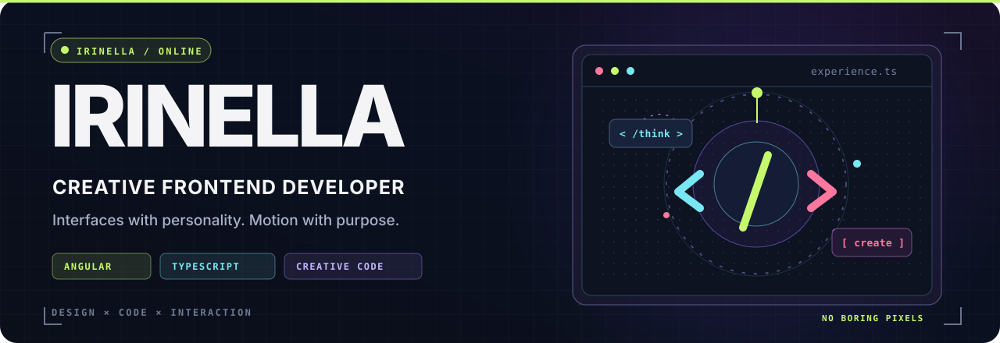
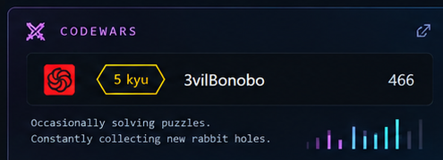
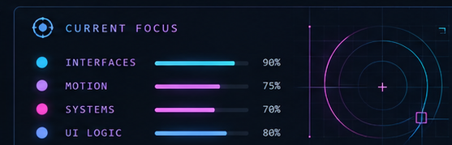
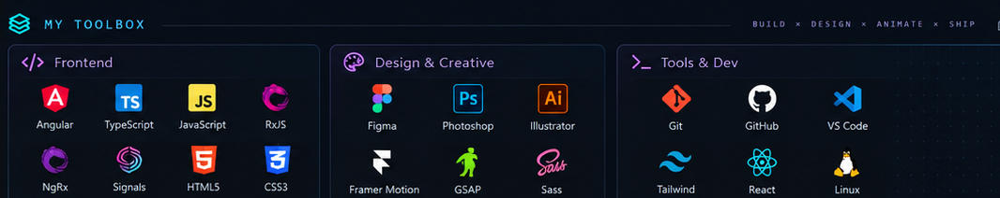

<!--
  Irinella B. / Creative Frontend Developer
  Screenshot-approved visual composition. All SVGs live beside README.md in the repository ROOT.
  Includes a tiny, optional SVG light pulse — no JavaScript.
-->

  

<!-- The two cards stay side by side without GitHub's default table borders. -->

  &nbsp;
  

  

<!-- The buttons shown in the hero artwork are decorative because GitHub cannot make
     separate regions inside an SVG  clickable. These real links work. -->

  
  
  
  

