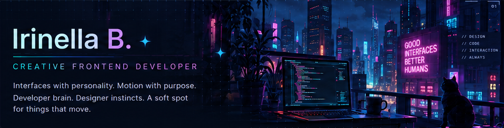
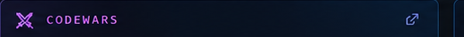
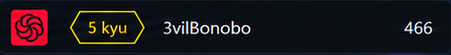
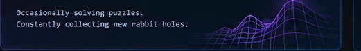
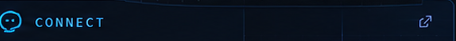
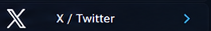
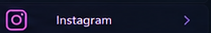
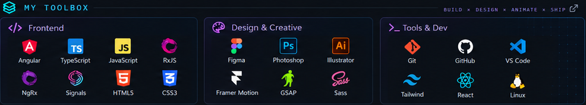

<!--
  Irinella B. | GitHub Profile README

  Light-mode-friendly layout:
  - No GitHub table background
  - Decorative images are not links
  - Codewars and each social button remain clickable
  - Uses existing ib-*.png files
-->

  <picture>
    
  </picture>

<!-- CODEWARS -->

  <picture>
    
  </picture>

  

  <picture>
    
  </picture>

<!-- CONNECT -->

  <picture>
    
  </picture>

  <picture>
    
  </picture>

  

   

  

   

  

   

  

 

<!-- TOOLBOX -->

  <picture>
    
  </picture>

