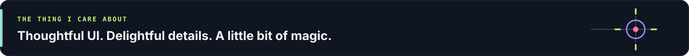
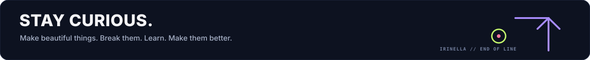

<!-- IRINELLA | Creative Frontend Developer -->

  

**Developer brain. Designer instincts. A soft spot for things that move.**

I make interfaces that are intuitive, expressive, and fun to interact with.

**Angular + TypeScript** are my home base. **UI/UX, creative coding, and animation** are where I happily lose track of time.

 

  

 

  

 

#### ⚔️ Little side quest: Codewars

Occasionally solving puzzles. Constantly collecting new rabbit holes.

 

  

